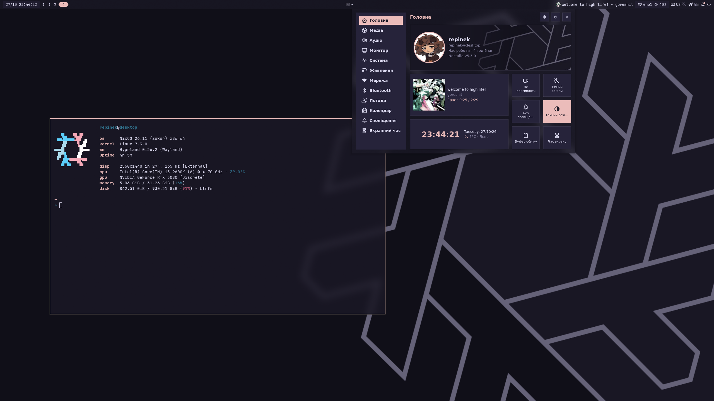
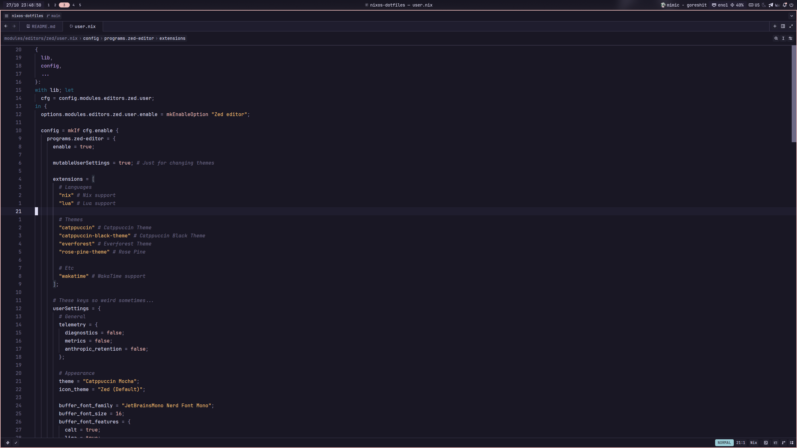

# repinek's NixOS dotfiles

Declarative [NixOS](https://nixos.org) configuration with Home Manager for daily personal use.

> Some NixOS dotfiles I've come across seem to be missing basic things you'd expect from a **daily-use computer**.  
> Like, are you really using just a WM, Vim, Git, and a browser? What about an office suite, a video player, a file explorer or literally anything else? We live in a **capitalist world**.  
> This configuration is my attempt at building a **complete, practical** desktop setup for _everyday use_, not just a minimal environment for writing code.
>
> Everyday convenience matters to me: opening files in the right applications, previewing them in the file manager, taking and annotating screenshots, sharing files between devices, etc.  
> I mostly use **open-source software**, though.  
> I use Nix to keep my setup _reproducible_, but I still configure some applications / features imperatively. Those manual settings are documented alongside the configuration.

##### Contents

- [Screenshots](#screenshots)
- [Features](#features)
- [Structure](#structure)
- [Usage](#usage)
- [TODO](#todo)
- [License](#license)
- [Credits](#credits)

## Screenshots




## Features

- Everyday applications for files, documents, media, creative work and communication
- Fully configured desktop experience with Hyprland and Noctalia Shell
- Theme management with Noctalia Shell for wallpapers, GTK, Qt5/6, KColorScheme, btop, Alacritty, Fastfetch, Hyprland, VSCodium, Obsidian, Vesktop, LibreWolf, and OBS Studio
- Useful [aliases](modules/shell/fish/fish-aliases.nix) in the shell
- Ergonomic [keybindings](modules/desktop/hypr/hyprland/keybinds.nix) in Hyprland
- Declarative configs for a lot of apps, including [LibreWolf](modules/programs/browsers/librewolf/user.nix), [VSCodium](modules/editors/vscodium/user.nix), [Obsidian](modules/editors/obsidian/user.nix), [Zed](modules/editors/zed/user.nix), Anki, Nemo, etc.
- Daily incremental [Btrfs backups](services/backup/) with seven-day retention

#### Architecture things

- Flake-based, mostly modular system
- Supports multiple hosts and users (not sure if I need multiple users for now tho)
- Secret management with [sops-nix](https://github.com/Mic92/sops-nix)
- My own [packages](pkgs/)

## Structure

```
nixos-dotfiles
├── assets                  # Static assets: screenshots, wallpapers, etc.
├── hosts                   # per-host configuration
│   └── desktop
│       ├── settings        # Host-specific settings
│       ├── home.nix        # Home Manager configuration for this host
│       ├── system.nix      # NixOS configuration for this host
│       └── hardware-configuration.nix
├── lib                     # Helpers
│   └── mkNixos.nix
├── modules                 # Reusable system and user modules
│   ├── cli
│   ├── core
│   │   ├── boot
│   │   ├── btrfs
│   │   ├── fonts
│   │   ├── nix
│   │   ├── packages        # Base system packages
│   │   ├── security
│   │   └── system
│   ├── desktop
│   │   ├── hypr            # hypr ecosystem
│   │   │   └── hyprland
│   │   ├── ly
│   │   ├── mime
│   │   ├── noctalia
│   │   └── theme
│   ├── editors
│   ├── games
│   ├── hardware
│   │   ├── audio
│   │   └── nvidia
│   ├── programs
│   └── shell
│       └── fish
├── pkgs                    # Custom packages (Standalone flake)
│   ├── google-sans
│   ├── ida-pro
│   ├── ida-pro-mcp
│   ├── flake.nix
│   └── README.md
├── services                # Reusable services
├── users                   # per-user configuration
│   └── repinek
│       ├── settings        # User-specific settings
│       ├── home.nix        # Home Manager configuration for this user
│       └── system.nix      # NixOS configuration for this user
└── flake.nix
```

## Usage

> [!WARNING]  
> This is my personal configuration, created only for me, for my personal hardware and workflow.  
> **DO NOT COPY & PASTE IT BLINDLY**  
> Use it only as a **reference** to build and configure your own config.

If you know what you are doing and just want to look around:

```bash
git clone https://github.com/repinek/nixos-dotfiles.git
cd nixos-dotfiles
```

## TODO

Not needed right now, just ideas for when I have free time

- [ ] Refactor the core folder a little
- [ ] Try Niri one day
- [ ] proxypin, httptoolkit, reqable* (or anything else for traffic capturing)

There are also several `FIXME` and `TODO` comments.

## License

This project is licensed under the **MIT License**.  
See the [LICENSE](LICENSE) file for details.

## Credits

- [datsfilipe dotfiles](https://github.com/datsfilipe/dotfiles) - The architecture is heavily inspired by these dotfiles
- [Ruject nixos-infra](https://git.ruject.fun/RuJect/nixos-infra) - Some modules and architectural ideas were adapted from this project
